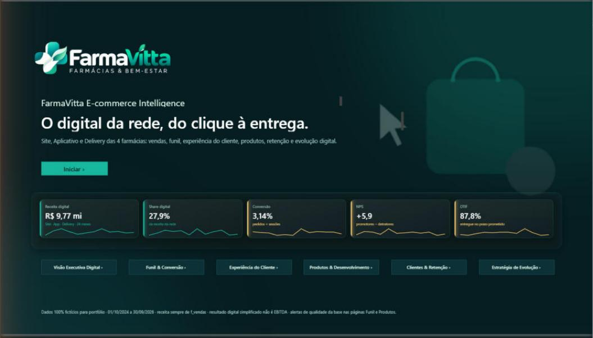
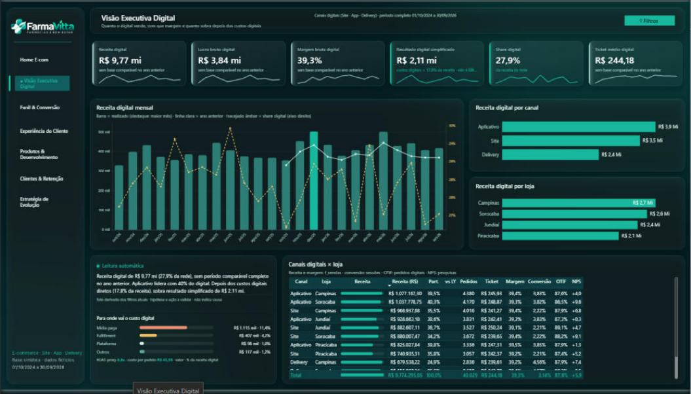
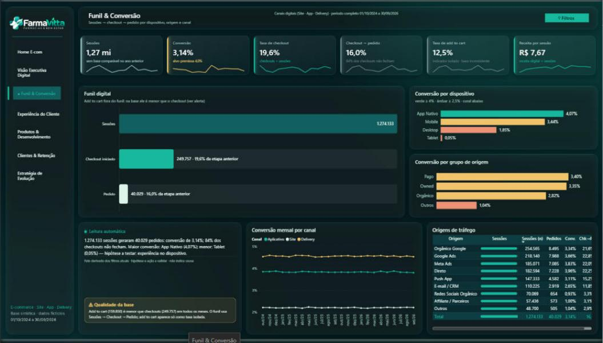
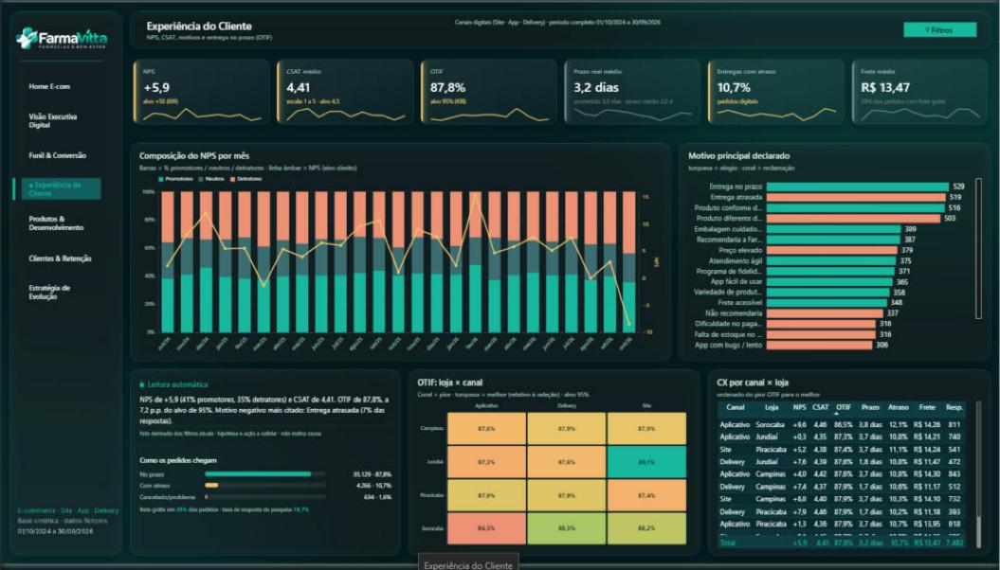
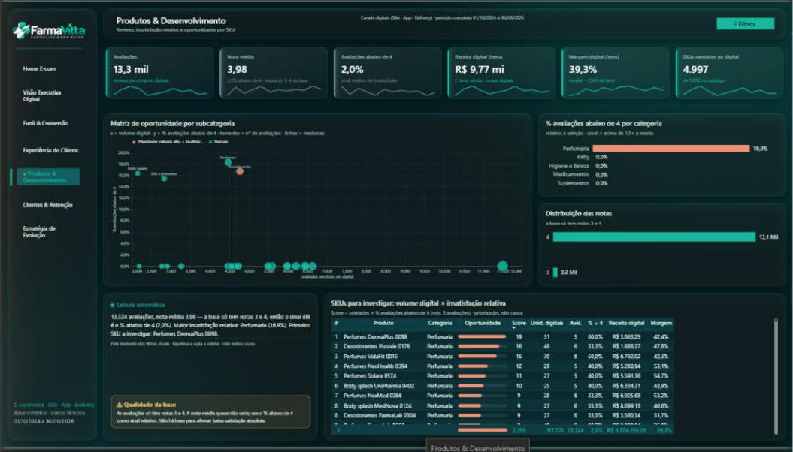
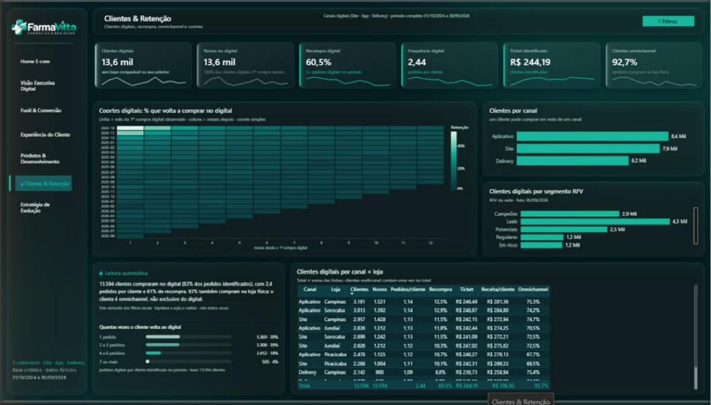
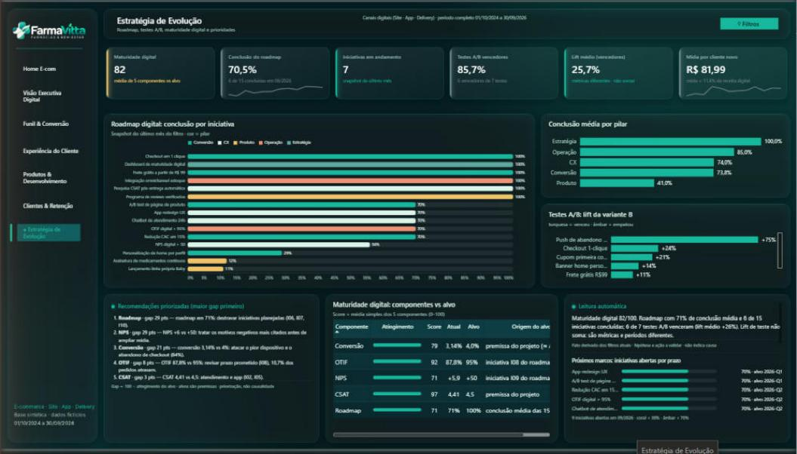

# FarmaVitta Digital: o e-commerce de uma rede de farmácias, do clique à entrega

Painel interativo em Power BI que mostra, em um só lugar, como estão as vendas online de uma rede de farmácias. Ele cobre quanto se vende, por onde o cliente chega, se a entrega chega no prazo, o que o cliente acha da compra e quais devem ser os próximos passos da operação digital.

> Projeto de portfólio com dados **100% fictícios**, criados para simular uma operação real de varejo farmacêutico.

---

## Contexto e objetivos
A FarmaVitta é uma rede fictícia de 4 farmácias no interior de São Paulo. Além das lojas físicas, ela vende por três canais digitais: site, aplicativo e delivery. Juntos, eles respondem por quase 28% do faturamento.

A informação estava espalhada: vendas de um lado, visitas ao site de outro, pesquisas de satisfação e prazos de entrega em arquivos separados. Faltava uma visão única que respondesse às perguntas do dia a dia de quem gerencia o digital:

- Quanto o digital vende e quanto realmente sobra depois dos custos de anúncios e entrega?
- De cada 100 visitas, quantas viram compra? Onde o cliente desiste?
- O cliente está satisfeito? A entrega chega no prazo prometido?
- Quais produtos merecem atenção?
- O cliente volta a comprar?
- As iniciativas de melhoria estão andando?

## Metodologia e abordagem
1. **Conferir antes de mostrar.** Antes de criar qualquer gráfico, verifiquei se os números batiam entre si: vendas, pedidos, visitas e pesquisas. Só segui quando tudo fechou.
2. **Uma pergunta por página.** O painel tem 7 telas, cada uma dedicada a um tema: visão geral, jornada de compra, experiência do cliente, produtos, clientes e estratégia.
3. **Leitura automática.** Cada página traz um pequeno texto que resume em linguagem simples o que os números mostram, e ele se atualiza conforme os filtros escolhidos.
4. **Cores que avisam.** Verde indica que está bem, amarelo pede atenção e coral sinaliza problema.
5. **Avisos honestos.** Onde os dados tinham limitações, o painel mostra um alerta em vez de esconder o problema.

## Desafios e aprendizados
- **Dados que não faziam sentido.** Os registros mostravam mais clientes chegando ao pagamento do que colocando produtos no carrinho, o que é impossível na prática. Em vez de mascarar isso, redesenhei a jornada de compra só com as etapas confiáveis e deixei o alerta visível.
- **Avaliações sem variação.** Todas as notas de produto eram 3 ou 4. Uma média de 3,98 parece boa, mas não diz nada. Passei a olhar para a proporção de notas abaixo de 4, o único sinal útil disponível.
- **Aprendizado principal:** um painel bonito com dados errados é pior do que nenhum painel. Conferir a base primeiro mudou o projeto inteiro.

## Insights descobertos
- **O aplicativo vende melhor.** No app, 4,1% das visitas viram compra. No computador são 1,9%, e no tablet quase ninguém compra (0,05%).
- **O cliente digital também é cliente da loja.** 93% de quem compra online também compra na loja física.
- **A entrega é o ponto sensível.** "Entrega no prazo" e "entrega atrasada" são os motivos mais citados nas pesquisas. Hoje, 88% dos pedidos chegam no prazo, e a meta é 95%.
- **A insatisfação com produtos está concentrada.** Todas as avaliações mais baixas são de Perfumaria.
- **Anúncio é o maior custo digital.** A mídia paga consome cerca de 11% da receita online. Depois de todos os custos digitais, sobram cerca de R$ 2,1 milhões em 24 meses.
- **O cliente volta.** 6 em cada 10 clientes digitais compraram mais de uma vez no período.

## Resultados de impacto
- **Uma visão única no lugar de várias planilhas:** vendas, jornada de compra, satisfação, entregas, produtos e clientes na mesma tela, com filtros por loja, canal e período.
- **Prioridades claras:** o painel ordena automaticamente onde está a maior distância até a meta.
- **Decisões mais rápidas:** perguntas como "qual loja atrasa mais as entregas?" passam a ter resposta em segundos.
- **Confiança nos números:** todos os indicadores foram conferidos com os dados de origem antes da entrega ([relatório de validação](07_Testes/VALIDACAO_FarmaVitta_Ecom.md)).

---

## Telas

| | |
|---|---|
|  |  |
|  |  |
|  |  |

## Como abrir
1. Baixe o repositório e instale o Power BI Desktop (versão recente, com suporte a PBIP).
2. Abra `04_PBIP/FarmaVitta_Ecom.pbip`.
3. Em **Transformar dados → Parâmetros**, troque `PastaProjeto` pela pasta onde você salvou o repositório (terminando com `\`).
4. Clique em **Atualizar**. Os visuais HTML Content e Deneb são baixados do AppSource e precisam de internet.

## Estrutura
| Pasta | Conteúdo |
|---|---|
| `01_Dados_Originais` | Base de vendas (24 meses) e base complementar de e-commerce (CSV, fictícias) |
| `02_Dados_Tratados` | Classificação ABC de produtos e segmentação RFV de clientes |
| `04_PBIP` | Projeto Power BI (modelo TMDL + relatório PBIR) e specs Deneb |
| `07_Testes` | Relatório de validação e prints |
| `10_Scripts` | Scripts Python que geram o projeto e a auditoria dos dados |

**Ferramentas:** Power BI (PBIP/PBIR/TMDL), DAX, Power Query, Deneb/Vega-Lite, HTML Content, Python.
